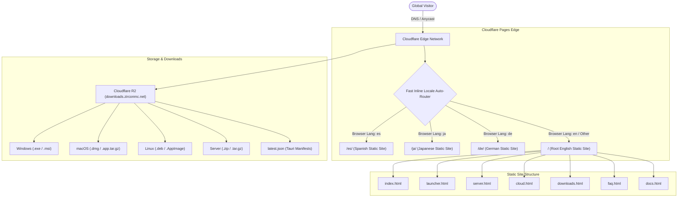
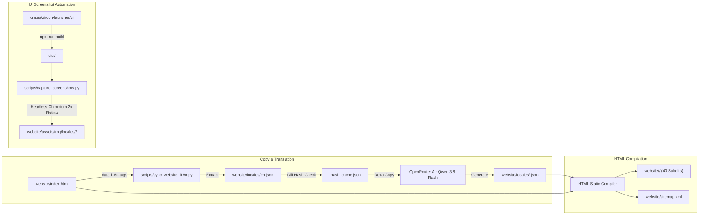

# Zircon Website Master Architecture & Operations Guide

> **Official Portal**: [zirconmc.net](https://zirconmc.net)  
> **Binary Distribution**: [downloads.zirconmc.net](https://downloads.zirconmc.net)  
> **Edge Host**: Cloudflare Pages (`project: zircon`)  
> **Storage Host**: Cloudflare R2 (`bucket: zircon-downloads`)  

---

## 1. Executive Summary & Market Dominance Vision

### The Global Opportunity in Minecraft
Minecraft has over **140 million monthly active players** across more than 100 countries. However, the ecosystem for third-party launchers (Prism Launcher, CurseForge App, Modrinth App, ATLauncher, FTB) and server managers (PufferPanel, AMP, Multicraft) suffers from two critical flaws:

1. **Extreme English Bias**: Over 90% of third-party tools and their websites are English-only. Huge gaming markets—such as **Brazil (Portuguese)**, **Latin America & Spain (Spanish)**, **Germany**, **France**, **Russia**, **Japan**, **China**, **Taiwan**, and **Turkey**—are treated as second-class citizens, forced to navigate English landing pages and English download instructions.
2. **Fragmented Workflows**: Players have to install one application to play, while server hosts have to navigate complex terminal commands or Docker setups on a completely different system.

### Zircon's Competitive Advantage
Zircon solves this with a cohesive, AAA-grade stack:
* **True Native Multilingual Edge**: A website and launcher that automatically detect the visitor's native language across **40 languages**, presenting localized marketing copy, localized feature carousels, and **native in-game UI screenshots in their language**.
* **Zero-Setup Unified Platform**: A single ecosystem containing both a high-performance Rust + Tauri companion launcher (with one-click mod sync and split-screen couch co-op) and a self-hosted server manager daemon.

When a player in São Paulo, Tokyo, or Berlin visits `zirconmc.net`, they don't see an English-only indie project—they see a localized platform built specifically for them. This creates a massive search engine moat (capturing international long-tail search queries) and converts visitors into active users at an unprecedented rate.

---

## 2. System Architecture



### Static Pre-Rendering Architecture
The website avoids client-side JavaScript translation rendering (which search engine crawlers hate) by using a **pre-rendered static directory architecture**:
* The root directory `website/` contains the master English source templates.
* 40 subdirectories (`website/es/`, `website/de/`, `website/ja/`, etc.) contain fully pre-compiled HTML files with all copy, `<title>`, `<meta description>`, OpenGraph tags, and canonical tags pre-injected.
* **Instant First Contentful Paint (FCP)**: Pages load in < 150ms on Cloudflare's global edge without waiting for client-side API calls.

---

## 3. The 40 Target Languages Registry

Zircon supports 40 major world languages representing >98% of the global internet gaming population:

| Language Code | English Name | Native Name | Directory | Hreflang | AI Translation Model |
| :--- | :--- | :--- | :--- | :--- | :--- |
| `en` | English | English | `/` | `en` (x-default) | Master Source |
| `es` | Spanish | Español | `/es/` | `es` | `qwen/qwen3.8-flash` |
| `pt-BR` | Portuguese (Brazil) | Português (Brasil) | `/pt-br/` | `pt-BR` | `qwen/qwen3.8-flash` |
| `pt-PT` | Portuguese (Portugal) | Português (Portugal) | `/pt-pt/` | `pt-PT` | `qwen/qwen3.8-flash` |
| `de` | German | Deutsch | `/de/` | `de` | `qwen/qwen3.8-flash` |
| `fr` | French | Français | `/fr/` | `fr` | `qwen/qwen3.8-flash` |
| `it` | Italian | Italiano | `/it/` | `it` | `qwen/qwen3.8-flash` |
| `ru` | Russian | Русский | `/ru/` | `ru` | `qwen/qwen3.8-flash` |
| `pl` | Polish | Polski | `/pl/` | `pl` | `qwen/qwen3.8-flash` |
| `nl` | Dutch | Nederlands | `/nl/` | `nl` | `qwen/qwen3.8-flash` |
| `tr` | Turkish | Türkçe | `/tr/` | `tr` | `qwen/qwen3.8-flash` |
| `sv` | Swedish | Svenska | `/sv/` | `sv` | `qwen/qwen3.8-flash` |
| `uk` | Ukrainian | Українська | `/uk/` | `uk` | `qwen/qwen3.8-flash` |
| `cs` | Czech | Čeština | `/cs/` | `cs` | `qwen/qwen3.8-flash` |
| `fi` | Finnish | Suomi | `/fi/` | `fi` | `qwen/qwen3.8-flash` |
| `da` | Danish | Dansk | `/da/` | `da` | `qwen/qwen3.8-flash` |
| `no` | Norwegian | Norsk Bokmål | `/no/` | `no` | `qwen/qwen3.8-flash` |
| `hu` | Hungarian | Magyar | `/hu/` | `hu` | `qwen/qwen3.8-flash` |
| `ro` | Romanian | Română | `/ro/` | `ro` | `qwen/qwen3.8-flash` |
| `el` | Greek | Ελληνικά | `/el/` | `el` | `qwen/qwen3.8-flash` |
| `bg` | Bulgarian | Български | `/bg/` | `bg` | `qwen/qwen3.8-flash` |
| `sk` | Slovak | Slovenčina | `/sk/` | `sk` | `qwen/qwen3.8-flash` |
| `hr` | Croatian | Hrvatski | `/hr/` | `hr` | `qwen/qwen3.8-flash` |
| `sr` | Serbian | Srpski | `/sr/` | `sr` | `qwen/qwen3.8-flash` |
| `sl` | Slovenian | Slovenščina | `/sl/` | `sl` | `qwen/qwen3.8-flash` |
| `lt` | Lithuanian | Lietuvių | `/lt/` | `lt` | `qwen/qwen3.8-flash` |
| `lv` | Latvian | Latviešu | `/lv/` | `lv` | `qwen/qwen3.8-flash` |
| `et` | Estonian | Eesti | `/et/` | `et` | `qwen/qwen3.8-flash` |
| `zh-CN` | Chinese (Simplified) | 简体中文 | `/zh-cn/` | `zh-CN` | `qwen/qwen3.8-flash` |
| `zh-TW` | Chinese (Traditional) | 繁體中文 | `/zh-tw/` | `zh-TW` | `qwen/qwen3.8-flash` |
| `ja` | Japanese | 日本語 | `/ja/` | `ja` | `qwen/qwen3.8-flash` |
| `ko` | Korean | 한국어 | `/ko/` | `ko` | `qwen/qwen3.8-flash` |
| `id` | Indonesian | Bahasa Indonesia | `/id/` | `id` | `qwen/qwen3.8-flash` |
| `vi` | Vietnamese | Tiếng Việt | `/vi/` | `vi` | `qwen/qwen3.8-flash` |
| `th` | Thai | ไทย | `/th/` | `th` | `qwen/qwen3.8-flash` |
| `ms` | Malay | Bahasa Melayu | `/ms/` | `ms` | `qwen/qwen3.8-flash` |
| `fil` | Filipino | Filipino | `/fil/` | `fil` | `qwen/qwen3.8-flash` |
| `hi` | Hindi | हिन्दी | `/hi/` | `hi` | `qwen/qwen3.8-flash` |
| `ar` | Arabic (RTL) | العربية | `/ar/` | `ar` | `qwen/qwen3.8-flash` |
| `he` | Hebrew (RTL) | עברית | `/he/` | `he` | `qwen/qwen3.8-flash` |
| `fa` | Persian (RTL) | فارسی | `/fa/` | `fa` | `qwen/qwen3.8-flash` |

---

## 4. Master Image & Media Registry

All website images are stored in `website/assets/img/`.

### Image Optimization Rules
1. **WebP Standard**: The live website serves **`.webp`** format for all photographic screenshots (compressed with quality 85–88, method 6). This delivers a 90% bandwidth reduction compared to raw `.png`.
2. **SVG Standard**: All logos, icons, mascots, and badges are stored as clean `.svg` vectors.
3. **HiDPI / Retina Standard**: All desktop screenshots are rendered at **2880×1800** (1440×900 base viewport with 2x device pixel ratio).

### Active Assets Inventory

#### A. Launcher Screenshots (`website/assets/img/`)
| Image File | Description | Used On |
| :--- | :--- | :--- |
| `lan_auto_discovery.webp` | Server Browser with active "Nearby Friends" local LAN cards | `index.html` (Hero Dock & Feature Slide 2), `launcher.html`, `docs.html` |
| `main_launcher.webp` | Modpack Instances Library (offline & modded instances grid) | `index.html` (Hero Dock), `launcher.html`, `README.md` |
| `sync_verification.webp` | Cryptographic Mod Sync Verification Card (hash checks with Modrinth & CurseForge) | `index.html` (Hero Dock & Mod Sync Feature) |
| `migration_importer.webp` | Universal 1-Click Importer (Prism, CurseForge, Modrinth) | `index.html`, `launcher.html` |
| `couch_coop_modal.webp` | 4-Player Split-Screen Couch Co-op Controller Configuration | `index.html`, `launcher.html` |
| `skin_selector_launcher.webp` | 3D Skin Studio with live interactive model preview | `index.html`, `launcher.html` |
| `settings_launcher.webp` | Launcher Engine Settings (RAM allocation slider, Java flags) | `launcher.html` |
| `launch_2048.webp` | Pre-launch loading screen with the interactive 2048 minigame | `index.html` (Delight Slide 3), `launcher.html` |

#### B. Server Manager Screenshots (`website/assets/img/`)
| Image File | Description | Used On |
| :--- | :--- | :--- |
| `performance_server.webp` | Live telemetry graphs (TPS, MSPT, CPU, RAM, Disk) | `index.html`, `server.html`, `README.md` |
| `mod_browser_server.webp` | In-app Modrinth & CurseForge 1-click mod installer | `server.html` |
| `console_log_server.webp` | Real-time WebSocket terminal log with command prompt | `server.html` |
| `players_server.webp` | Live player tracking, ops, whitelist, and kick/ban tools | `server.html` |
| `backups_server.webp` | Automated LZ4 snapshot manager and 1-click restore | `server.html` |
| `files_server.webp` | Embedded Web File Manager with inline syntax editor | `server.html` |
| `settings_server.webp` | `server.properties` visual editor and engine configs | `server.html` |

#### C. Mascots, Branding & Ecosystem Logos (Protected)
| Image File | Description |
| :--- | :--- |
| `zirky.svg` | Official Zircon Mascot (Default Pose) |
| `zirky-idle.svg` | Zirky (Idle standing pose) |
| `zirky-tinkering.svg` | Zirky (Engineering/modding wrench pose) |
| `zirky-sleeping.svg` | Zirky (Idle server sleep mode pose) |
| `zirky-alert.svg` | Zirky (Important notice/alert pose) |
| `zirky-celebrating.svg` | Zirky (Celebration/success pose) |
| `zircon-title.svg` | Primary holographic Zircon logo header |
| `zircon-icon.svg` | Official high-resolution Zircon jewel icon |
| `zircon-cloud-title.svg` | Zircon Cloud header logo |
| `favicon.png` | Browser favicon (PNG fallback) |
| `curseforge.svg` | CurseForge Partner Icon |
| `modrinth.svg` | Modrinth Partner Icon |
| `prism.svg` | Prism Launcher Migration Partner Icon |
| `atlauncher.svg` | ATLauncher Migration Partner Icon |
| `discord.svg` | Discord Integration Icon |
| `microsoft.svg` | Official Microsoft Sign-in Badge |

---

## 5. The Automation Engine



### Script 1: `scripts/sync_website_i18n.py`
The master localization engine:
1. **Content-Hash Diffing**: Computes MD5 hashes of all copy in `website/locales/.hash_cache.json`. When you edit English copy, it only sends the **changed strings** to OpenRouter, saving 99% of API costs.
2. **AI Translation**: Translates delta strings into all 40 target languages using `qwen/qwen3.8-flash` (fast, culturally fluent, and cost-effective).
3. **Static Generation**: Injects localized copy, `<title>`, `<meta description>`, OpenGraph tags, canonical tags, and hreflang blocks into all 40 static directories.
4. **Sitemap Generation**: Produces a clean `website/sitemap.xml` with 246 canonical URLs without `.html` extensions.

### Script 2: `scripts/capture_screenshots.py`
The launcher UI screenshot pipeline:
1. Starts a headless local static server on `http://127.0.0.1:4173` serving the compiled Vue dist.
2. Launches **Playwright Chromium** configured for 1440×900 at **2x Device Pixel Ratio** (2880×1800 Retina).
3. Sets dark color scheme and disables first-run onboarding modals.
4. Navigates to each view with `?mock=1&lang=<lang>`, waits for network idle and animations to settle, captures crisp PNGs, and converts them to optimized `.webp`.

### Script 3: `scripts/capture_server_screenshots.py`
The server manager web app screenshot pipeline:
1. Serves the embedded single-page dashboard at `crates/zircon-server/assets/web/`.
2. Intercepts `/api/**` calls via Playwright route interception and mocks realistic TPS, MSPT, player lists, and console streams.
3. Captures all 7 server tabs (`performance_server`, `mod_browser_server`, `console_log_server`, `players_server`, `backups_server`, `files_server`, `settings_server`).

### Script 4: `scripts/deploy_pages.py` & CI Deployment
1. Reads Cloudflare credentials from `.env` or GitHub Secrets.
2. Deploys the static `website/` directory directly to **Cloudflare Pages** (`project: zircon`) using Cloudflare Wrangler.

---

## 6. SEO, Canonical URLs, and Search Engine Rules

### 1. Clean Canonical URLs (No `.html`)
Cloudflare Pages automatically canonicalizes static HTML files by stripping the `.html` extension:
* `/launcher.html` $\rightarrow$ `308 Permanent Redirect` $\rightarrow$ `/launcher`
* **Rule**: All `<link rel="canonical">` tags, navigation `href` links, and `<loc>` entries in `sitemap.xml` **must use clean extensionless URLs** (`https://zirconmc.net/launcher`, not `.html`).

### 2. Bidirectional Multilingual Hreflang Tags
Every HTML page in every language must include self-referencing and alternate hreflang tags:
```html
<link rel="canonical" href="https://zirconmc.net/launcher">
<link rel="alternate" hreflang="x-default" href="https://zirconmc.net/launcher">
<link rel="alternate" hreflang="en" href="https://zirconmc.net/launcher">
<link rel="alternate" hreflang="es" href="https://zirconmc.net/es/launcher">
<link rel="alternate" hreflang="pt-BR" href="https://zirconmc.net/pt-br/launcher">
...
```
This signals to Google that these 40 pages are localized variations of each other rather than duplicate content.

---

## 7. Operational Playbooks

### Workflow A: Editing Website Copy
1. Edit the copy directly in the master English file (e.g. `website/index.html`).
2. Run the build command to update the sitemap and recompile static subdirectories:
   ```powershell
   python scripts/sync_website_i18n.py --build
   ```
3. To trigger AI translation of newly added copy:
   ```powershell
   python scripts/sync_website_i18n.py --all
   ```

### Workflow B: Capturing Screenshots
1. Recompile the Vue UI frontend:
   ```powershell
   npm --prefix crates/zircon-launcher/ui run build
   ```
2. Capture English screenshots:
   ```powershell
   python scripts/capture_screenshots.py --lang en
   ```
3. Or capture all 40 languages:
   ```powershell
   python scripts/capture_screenshots.py --all
   ```

### Workflow C: Deploying to Cloudflare Pages
* **Direct CLI Deploy**:
  ```powershell
  python scripts/deploy_pages.py
  ```
* **Official Release Deploy**:
  Run `release.bat <version>`, which automatically tags the release, runs multi-platform GitHub Actions builds, and deploys the website and binaries to Cloudflare Pages and R2.

---

## 8. Definitive Page-by-Page Image & Slot Inventory

This inventory documents all **78 image slots** across the 7 master English pages of the website. Every image tag, OpenGraph tag, and screenshot slot is audited with its exact line number, context, current source, and resolution status.

---

### Page 1: `website/index.html` (20 Image Slots)

The primary marketing landing page and most critical conversion surface of the website:

| Line | Slot Type | Current Image | Slot Context / Section | Status & Recommended Image |
| :--- | :--- | :--- | :--- | :--- |
| `434` | `` | `assets/img/zircon-title.svg` | Desktop Navigation Brand Header | **Optimal** (`zircon-title.svg`) |
| `466` | `` | `assets/img/zircon-title.svg` | Hero Centered Holographic Title | **Optimal** (`zircon-title.svg`) |
| `517` | `` | `assets/img/lan_auto_discovery.webp` | Hero Dock Tab 1 ("Servers") | **Optimal** (Shows active LAN friends & server list) |
| `521` | `` | `assets/img/main_launcher.webp` | Hero Dock Tab 2 ("Instances") | **Optimal** (Shows offline modded instances grid) |
| `525` | `` | `assets/img/sync_verification.webp` | Hero Dock Tab 3 ("Mod Sync") | **Needs Re-capture** (Clean, focused card without 2048) |
| `529` | `` | `assets/img/migration_importer.webp` | Hero Dock Tab 4 ("Migration") | **Optimal** (Shows 1-click import from Prism/CurseForge) |
| `533` | `` | `assets/img/couch_coop_modal.webp` | Hero Dock Tab 5 ("Couch Co-op") | **Optimal** (Shows 4-player split-screen gamepad mapping) |
| `537` | `` | `assets/img/skin_selector_launcher.webp` | Hero Dock Tab 6 ("3D Skin Studio")| **Optimal** (Shows 3D skin model and selector) |
| `642` | `` | `assets/img/sync_verification.webp` | Feature 1: "Sub-Second Mod Sync" | **Needs Re-capture** (Clean, focused card without 2048) |
| `658` | `` | `assets/img/curseforge.svg` | Migration Grid: CurseForge Badge | **Optimal** (`curseforge.svg`) |
| `665` | `` | `assets/img/prism.svg` | Migration Grid: Prism Launcher Badge | **Optimal** (`prism.svg`) |
| `672` | `` | `assets/img/modrinth.svg` | Migration Grid: Modrinth Badge | **Optimal** (`modrinth.svg`) |
| `679` | `` | `assets/img/atlauncher.svg` | Migration Grid: ATLauncher Badge | **Optimal** (`atlauncher.svg`) |
| `713` | `` | `assets/img/migration_importer.webp` | Feature 2: "Universal Migration" | **Optimal** (Large migration window preview) |
| `868` | `` | `assets/img/couch_coop_modal.webp` | Delight Carousel Slide 0 (Couch Co-op) | **Optimal** (Split-screen controller view) |
| `892` | `` | `assets/img/skin_selector_launcher.webp` | Delight Carousel Slide 1 (3D Skin Studio) | **Optimal** (3D Skin studio view) |
| `916` | `` | `assets/img/lan_auto_discovery.webp` | Delight Carousel Slide 2 (LAN Auto-Discovery)| **Optimal** (Shows 2 active nearby friends) |
| `940` | `` | `assets/img/main_launcher.webp` | Delight Carousel Slide 3 (2048 Minigame)| **FIX REQUIRED**: Currently shows instances grid; change to `launch_2048.webp` |
| `1106`| `` | `assets/img/performance_server.webp` | Server Showcase: Performance Dashboard | **Optimal** (Live TPS/MSPT graphs & stats) |
| `1314`| `` | `assets/img/zircon-title.svg` | Footer Brand Logo | **Optimal** (`zircon-title.svg`) |

---

### Page 2: `website/launcher.html` (18 Image Slots)

The dedicated Companion Launcher deep-dive product page:

| Line | Slot Type | Current Image | Slot Context / Section | Status & Recommended Image |
| :--- | :--- | :--- | :--- | :--- |
| `148` | `` | `assets/img/zircon-title.svg` | Navigation Brand Header | **Optimal** (`zircon-title.svg`) |
| `211` | `` | `assets/img/lan_auto_discovery.webp` | Main Carousel Slide 1: Server Dashboard | **Optimal** (`lan_auto_discovery.webp`) |
| `223` | `` | `assets/img/migration_importer.webp` | Main Carousel Slide 2: Migration Importer | **Optimal** (`migration_importer.webp`) |
| `235` | `` | `assets/img/couch_coop_modal.webp` | Main Carousel Slide 3: Couch Co-op Setup | **Optimal** (`couch_coop_modal.webp`) |
| `247` | `` | `assets/img/skin_selector_launcher.webp` | Main Carousel Slide 4: 3D Skin Studio | **Optimal** (`skin_selector_launcher.webp`) |
| `259` | `` | `assets/img/lan_auto_discovery.webp` | Main Carousel Slide 5: LAN Auto-Discovery | **Optimal** (`lan_auto_discovery.webp`) |
| `271` | `` | `assets/img/settings_launcher.webp` | Main Carousel Slide 6: 2048 While You Wait | **FIX REQUIRED**: Currently shows settings; change to `launch_2048.webp` |
| `296` | `` | `assets/img/lan_auto_discovery.webp` | Carousel Thumbnail 1: Main Launcher | **Optimal** (`lan_auto_discovery.webp`) |
| `297` | `` | `assets/img/migration_importer.webp` | Carousel Thumbnail 2: Migration | **Optimal** (`migration_importer.webp`) |
| `298` | `` | `assets/img/couch_coop_modal.webp` | Carousel Thumbnail 3: Couch Co-op | **Optimal** (`couch_coop_modal.webp`) |
| `299` | `` | `assets/img/skin_selector_launcher.webp` | Carousel Thumbnail 4: Skin Selector | **Optimal** (`skin_selector_launcher.webp`) |
| `300` | `` | `assets/img/lan_auto_discovery.webp` | Carousel Thumbnail 5: LAN Friends | **Optimal** (`lan_auto_discovery.webp`) |
| `301` | `` | `assets/img/settings_launcher.webp` | Carousel Thumbnail 6: 2048 & Discord | **FIX REQUIRED**: Change to `launch_2048.webp` |
| `336` | `` | `assets/img/migration_importer.webp` | Feature Deep Dive 1: Migration Window | **Optimal** (`migration_importer.webp`) |
| `371` | `` | `assets/img/couch_coop_modal.webp` | Feature Deep Dive 2: Split-Screen Setup | **Optimal** (`couch_coop_modal.webp`) |
| `406` | `` | `assets/img/skin_selector_launcher.webp` | Feature Deep Dive 3: 3D Skin Studio | **Optimal** (`skin_selector_launcher.webp`) |
| `441` | `` | `assets/img/lan_auto_discovery.webp` | Feature Deep Dive 4: LAN Auto-Discovery | **Optimal** (`lan_auto_discovery.webp`) |
| `507` | `` | `assets/img/zircon-title.svg` | Footer Brand Logo | **Optimal** (`zircon-title.svg`) |

---

### Page 3: `website/server.html` (24 Image Slots)

The dedicated Server Manager deep-dive product page:

| Line | Slot Type | Current Image | Slot Context / Section | Status & Recommended Image |
| :--- | :--- | :--- | :--- | :--- |
| `148` | `` | `assets/img/zircon-title.svg` | Navigation Brand Header | **Optimal** (`zircon-title.svg`) |
| `201` | `` | `assets/img/performance_server.webp` | Main Carousel Slide 1: Performance Stats | **Optimal** (TPS/MSPT charts) |
| `213` | `` | `assets/img/mod_browser_server.webp` | Main Carousel Slide 2: In-App Mod Browser | **Optimal** (CurseForge/Modrinth search) |
| `225` | `` | `assets/img/console_log_server.webp` | Main Carousel Slide 3: Live Terminal Console| **Optimal** (Colorized terminal stream) |
| `237` | `` | `assets/img/shaders_server.webp` | Main Carousel Slide 4: Shaders & Packs | **Optimal** (Shaderpack manager) |
| `249` | `` | `assets/img/files_server.webp` | Main Carousel Slide 5: Web File Manager | **Optimal** (Directory tree explorer) |
| `261` | `` | `assets/img/files_text_editor.webp` | Main Carousel Slide 6: In-Browser Editor | **Optimal** (Syntax-highlighted file editor)|
| `273` | `` | `assets/img/players_server.webp` | Main Carousel Slide 7: Player Management | **Optimal** (Online players, ops, whitelist) |
| `285` | `` | `assets/img/backups_server.webp` | Main Carousel Slide 8: Automated Backups | **Optimal** (LZ4 snapshots & retention) |
| `297` | `` | `assets/img/world_seed_radar.webp` | Main Carousel Slide 9: Live World Map | **Optimal** (Canvas biome radar & seed explorer) |
| `309` | `` | `assets/img/settings_server.webp` | Main Carousel Slide 10: Server Settings | **Optimal** (`server.properties` visual editor) |
| `338` | `` | `assets/img/performance_server.webp` | Carousel Thumbnail 1: Stats | **Optimal** |
| `339` | `` | `assets/img/mod_browser_server.webp` | Carousel Thumbnail 2: Mod Browser | **Optimal** |
| `340` | `` | `assets/img/console_log_server.webp` | Carousel Thumbnail 3: Console | **Optimal** |
| `341` | `` | `assets/img/shaders_server.webp` | Carousel Thumbnail 4: Shaders | **Optimal** |
| `342` | `` | `assets/img/files_server.webp` | Carousel Thumbnail 5: Files | **Optimal** |
| `343` | `` | `assets/img/files_text_editor.webp` | Carousel Thumbnail 6: Editor | **Optimal** |
| `344` | `` | `assets/img/players_server.webp` | Carousel Thumbnail 7: Players | **Optimal** |
| `345` | `` | `assets/img/backups_server.webp` | Carousel Thumbnail 8: Backups | **Optimal** |
| `346` | `` | `assets/img/world_seed_radar.webp` | Carousel Thumbnail 9: World Map | **Optimal** |
| `347` | `` | `assets/img/settings_server.webp` | Carousel Thumbnail 10: Settings | **Optimal** |
| `382` | `` | `assets/img/console_log_server.webp` | Feature Deep Dive 1: Real-Time Console | **Optimal** (`console_log_server.webp`) |
| `417` | `` | `assets/img/files_text_editor.webp` | Feature Deep Dive 2: Web Config Editor | **Optimal** (`files_text_editor.webp`) |
| `504` | `` | `assets/img/zircon-title.svg` | Footer Brand Logo | **Optimal** (`zircon-title.svg`) |

---

### Page 4: `website/faq.html` (2 Image Slots)

Frequently Asked Questions and technical clarifications:

| Line | Slot Type | Current Image | Slot Context / Section | Status & Recommended Image |
| :--- | :--- | :--- | :--- | :--- |
| `197` | `` | `assets/img/zircon-title.svg` | Navigation Brand Header | **Optimal** (`zircon-title.svg`) |
| `361` | `` | `assets/img/zircon-title.svg` | Footer Brand Logo | **Optimal** (`zircon-title.svg`) |

---

### Page 5: `website/docs.html` (8 Image Slots)

Documentation, setup tutorials, and quickstart guides:

| Line | Slot Type | Current Image | Slot Context / Section | Status & Recommended Image |
| :--- | :--- | :--- | :--- | :--- |
| `78`  | `og:image` | `https://zirconmc.net/assets/img/lan_auto_discovery.webp` | OpenGraph Social Sharing Card | **Optimal** |
| `108` | `` | `assets/img/zircon-title.svg` | Navigation Brand Header | **Optimal** (`zircon-title.svg`) |
| `214` | `` | `assets/img/lan_auto_discovery.webp` | Player Guide Step 3: Launcher Main Screen | **Optimal** (`lan_auto_discovery.webp`) |
| `230` | `` | `assets/img/offline_instances.webp` | Player Guide Step 4: Modpack Instances | **Optimal** (`offline_instances.webp`) |
| `246` | `` | `assets/img/skin_selector_launcher.png` | Player Guide Step 5: 3D Skin Studio | **FIX REQUIRED**: Change `.png` to `skin_selector_launcher.webp` |
| `281` | `` | `assets/img/performance_server.webp` | Host Guide Step 3: Web Dashboard | **Optimal** (`performance_server.webp`) |
| `305` | `` | `assets/img/mod_browser_server.png` | Host Guide Step 4: Server Mod Manager | **FIX REQUIRED**: Change `.png` to `mod_browser_server.webp` |
| `346` | `` | `assets/img/zircon-title.svg` | Footer Brand Logo | **Optimal** (`zircon-title.svg`) |

---

### Page 6: `website/cloud.html` (4 Image Slots)

The upcoming Zircon Cloud managed infrastructure landing page:

| Line | Slot Type | Current Image | Slot Context / Section | Status & Recommended Image |
| :--- | :--- | :--- | :--- | :--- |
| `173` | `` | `assets/img/zircon-title.svg` | Navigation Brand Header | **Optimal** (`zircon-title.svg`) |
| `306` | `` | `assets/img/zirky.svg` | Zirky AI Cloud Assistant Feature Card | **Optimal** (`zirky.svg` mascot) |
| `356` | `` | `assets/img/zircon-title.svg` | Cloud Architecture Section Header | **Optimal** (`zircon-title.svg`) |
| `486` | `` | `assets/img/zircon-title.svg` | Footer Brand Logo | **Optimal** (`zircon-title.svg`) |

---

### Page 7: `website/downloads.html` (2 Image Slots)

Official download hub for Windows, macOS, Linux, and standalone server packages:

| Line | Slot Type | Current Image | Slot Context / Section | Status & Recommended Image |
| :--- | :--- | :--- | :--- | :--- |
| `206` | `` | `assets/img/zircon-title.svg` | Navigation Brand Header | **Optimal** (`zircon-title.svg`) |
| `533` | `` | `assets/img/zircon-title.svg` | Footer Brand Logo | **Optimal** (`zircon-title.svg`) |

---

## 9. Immediate Image Action Checklist

To make the English site 100% accurate before running multilingual screenshot translation:

1. **Fix `index.html` Line 940**: Point Slide 3 from `main_launcher.webp` $\rightarrow$ `launch_2048.webp`.
2. **Fix `launcher.html` Lines 271 & 301**: Point Slide 6 & Thumbnail 6 from `settings_launcher.webp` $\rightarrow$ `launch_2048.webp`.
3. **Fix `docs.html` Lines 246 & 305**: Update the legacy `.png` links to modern `.webp` (`skin_selector_launcher.webp` and `mod_browser_server.webp`).
4. **Re-capture `sync_verification.webp`**: Capture the clean, focused mod verification dialog without 2048 taking over half the card.
5. **Capture `launch_2048.webp`**: Capture the dual-pane modal with an active, colorful 2048 board and score.


